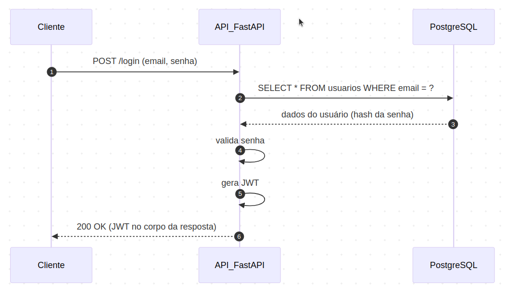
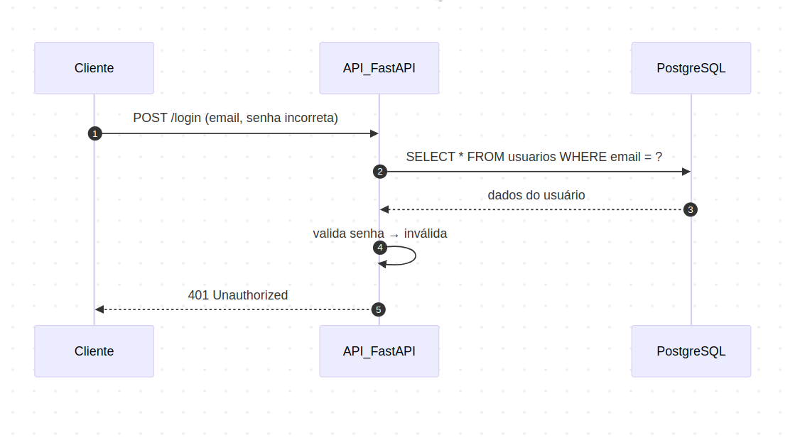
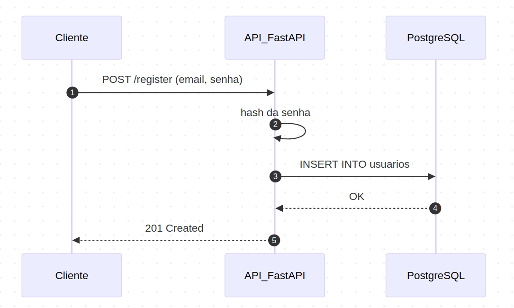
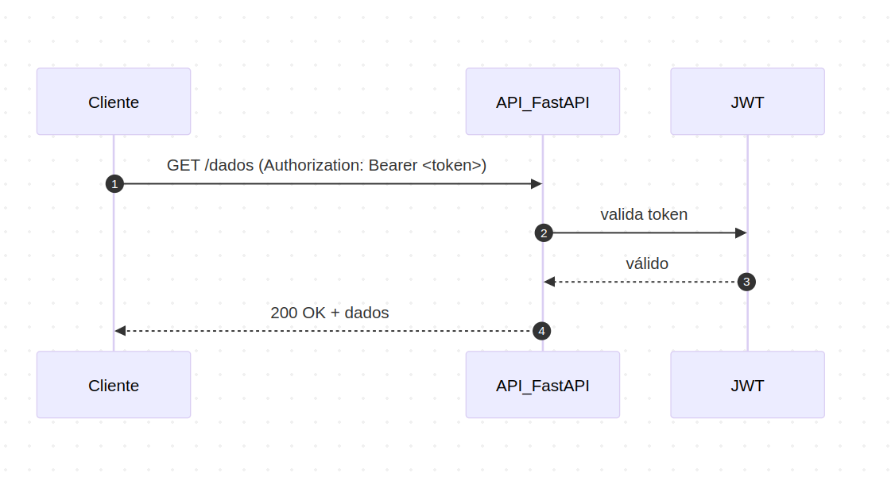
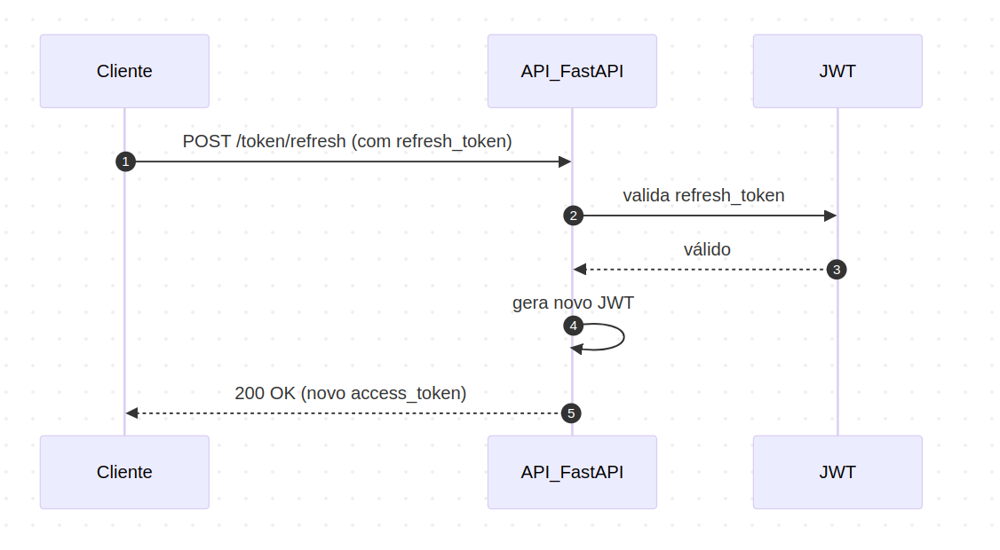
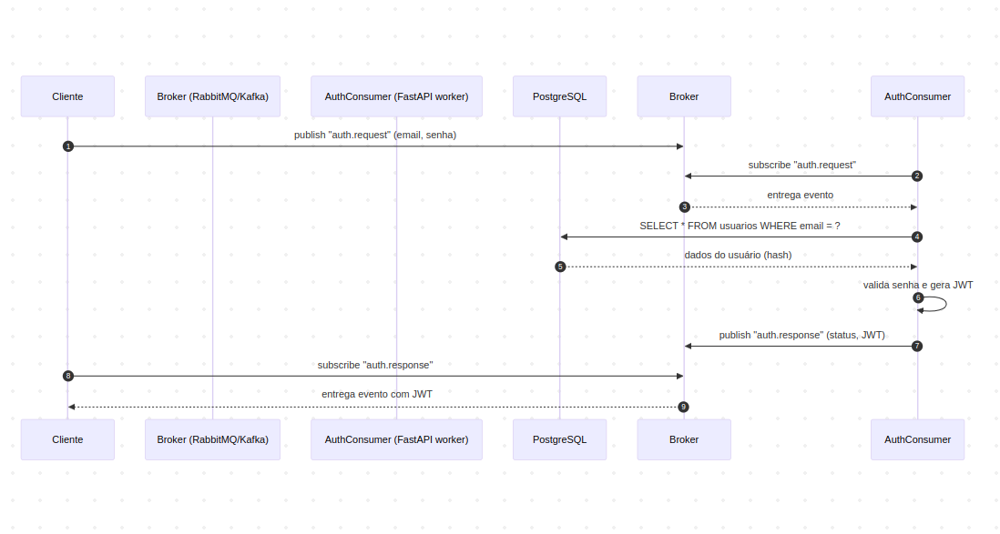
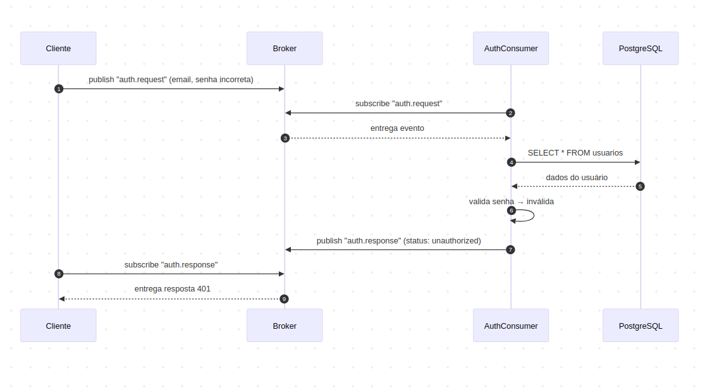
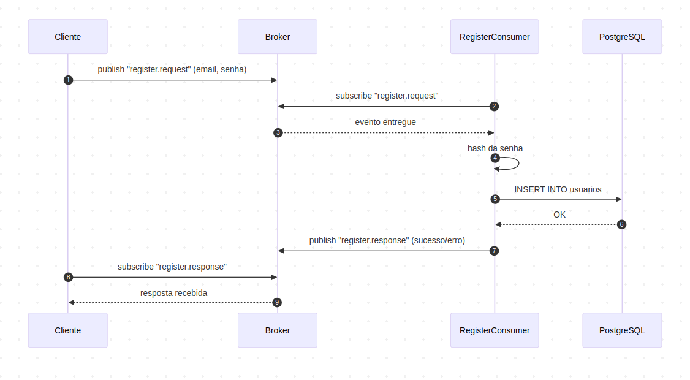
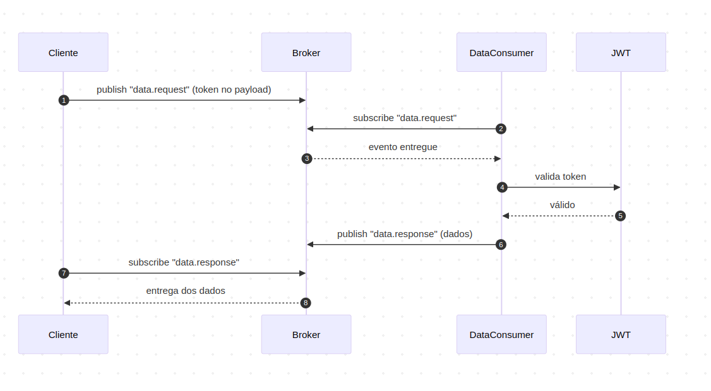
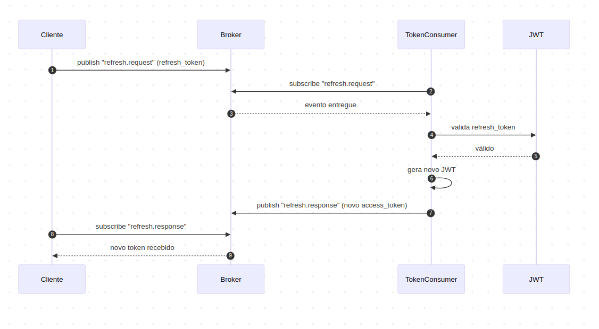

# Diagrama de Sequêcia

## Projeto A
* Login (Autenticar Usuário)

* Login (Com falha de autenticação)

* Registrar Usuário

* Acessar recurso protegido

* Refresh de token

## Projeto B
* Login (Autenticar Usuário)

* Login (Com falha de autenticação)

* Registrar Usuário

* Acessar recurso protegido

* Refresh de token

[página principal](../README.md)